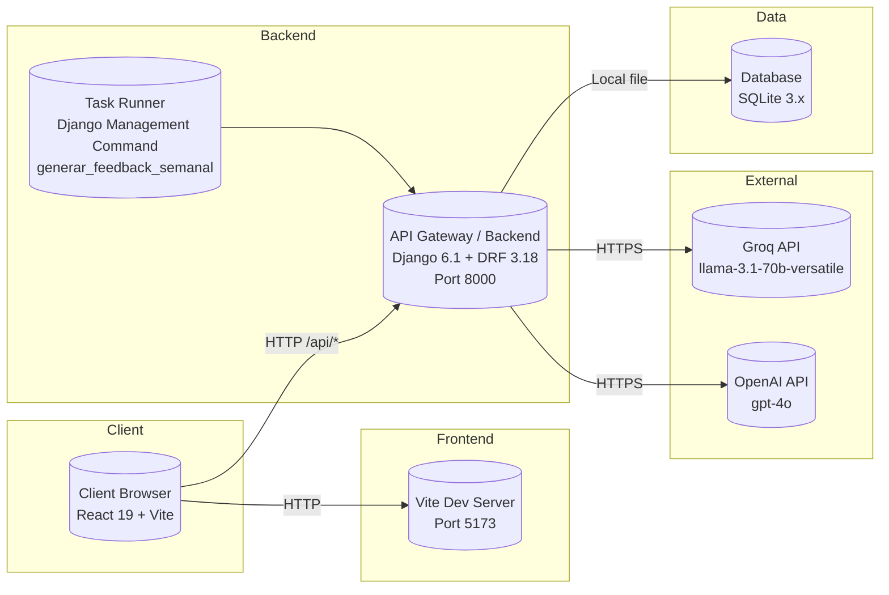
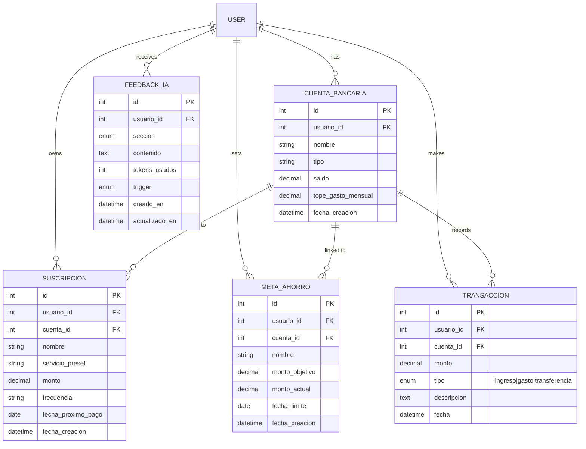

# Wiki_03 — MVP Deliverable 3

---

## 1. Architecture & Data

### 1.1 Deployment Diagram

**Description:**  
The system follows a **client-server architecture** with a React SPA frontend communicating via REST API to a Django backend, which persists data in SQLite (development) and integrates with external LLM providers (Groq/OpenAI) for AI-powered financial feedback.

**Nodes & Technologies:**

| Node | Technology | Version | Purpose |
|------|------------|---------|---------|
| **Client Browser** | React 19 + Vite | 19.2.8 / 8.3.0 | SPA rendering, routing, state management |
| **Frontend Dev Server** | Vite Dev Server | 8.3.0 | Hot-module replacement, proxy to backend |
| **API Gateway / Backend** | Django 6.1 + DRF 3.18 | 6.1.1 / 3.18.1 | REST endpoints, auth, business logic, ORM |
| **Database** | SQLite | 3.x (via sqlparse 0.6.0) | Persistent storage (dev) |
| **Task Runner** | Django Management Commands | — | Weekly feedback generation cron |
| **External AI Service** | Groq API (default) / OpenAI API | llama-3.1-70b-versatile / gpt-4o | LLM inference for financial feedback |

**Network Connections:**
- Browser → Frontend Dev Server: HTTP (port 5173 default)
- Browser → Backend API: HTTP (port 8000) via Vite proxy `/api/*`
- Backend → Database: Local file (SQLite)
- Backend → Groq/OpenAI: HTTPS (api.groq.com / api.openai.com)

**Changes from Previous Sprint:**
- Added **External AI Service** node for LLM integration
- Added **Task Runner** node for `generar_feedback_semanal` management command
- Frontend now includes **Feedback** page (`/feedback`) consuming `/ia/feedback/` endpoints



---

### 1.2 Component Diagram

**Architectural Overview:**  
The backend implements **Domain-Driven Design (DDD)** with clear layer separation. The frontend is organized by feature modules (pages/components).

#### Backend Components (Django Apps)

```
┌─────────────────────────────────────────────────────────────────┐
│                        DJANGO PROJECT (core)                     │
├──────────────────┬────────────────────┬────────────────────────┤
│     app/         │   transacciones/   │      app/ia/           │
│  (Accounts,      │  (Transactions,    │   (AI Feedback)        │
│   Goals, Subs)   │   Transfers)       │                        │
└────────┬─────────┴────────┬───────────┴──────────┬─────────────┘
         │                 │                      │
         ▼                 ▼                      ▼
┌─────────────────────────────────────────────────────────────────┐
│                     DOMAIN LAYER (Pure Business Logic)           │
│  • transacciones/domain/  →  Empty (reserved for future entities)│
│  • app/models.py          →  CuentaBancaria, Suscripcion,       │
│                              MetaAhorro, FeedbackIA              │
└─────────────────────────────────────────────────────────────────┘
         │
         ▼
┌─────────────────────────────────────────────────────────────────┐
│                   INFRASTRUCTURE LAYER                           │
│  • transacciones/infra/   →  Empty (reserved for repos)         │
│  • Django ORM             →  DB access via models               │
└─────────────────────────────────────────────────────────────────┘
         │
         ▼
┌─────────────────────────────────────────────────────────────────┐
│                    SERVICES LAYER (Use Cases)                    │
│  • transacciones/services.py → TransaccionService               │
│      - registrar_gasto_con_proteccion_meta()                    │
│      - obtener_reporte_financiero()                             │
│  • app/services.py         → procesar_autodebitos_suscripciones()│
│  • app/ia/services.py      → FeedbackIAService, LLMClient       │
└─────────────────────────────────────────────────────────────────┘
         │
         ▼
┌─────────────────────────────────────────────────────────────────┐
│                      API LAYER (DRF Views)                       │
│  • transacciones/views.py  → ListaTransaccionesView,            │
│      DetalleTransaccionView, ReporteFinancieroView,             │
│      TransferenciaEntreCuentasView, RegistrarUsuarioView,       │
│      LoginUsuarioView                                           │
│  • app/views.py            → Cuentas CRUD, Suscripciones CRUD,  │
│      Metas CRUD, Auto-debit processing                          │
│  • app/ia/views.py         → ContextoFinancieroView,            │
│      FeedbackIAView, FeedbackStatsView                          │
└─────────────────────────────────────────────────────────────────┘
```

#### Frontend Components (React)

```
App.jsx (Router + Global State: usuario, cuentas, suscripciones)
│
├── UserSelection (Login/Register)
│
├── Sidebar (Navigation + Subscription alerts badge)
│
├── Pages:
│   ├── Dashboard (/dashboard) → AccountsManager
│   │    ├── AccountDetailModal
│   │    └── TransactionForm
│   ├── Suscripciones (/suscripciones) → SubscriptionsManager
│   ├── Analytics (/analytics) → AnalyticsDashboard
│   ├── Metas (/metas) → GoalsManager
│   └── Feedback (/feedback) → Feedback (6 tabs: General, Cuentas, Gastos, Metas, Suscripciones, Reportes)
│
├── Shared Components:
│   ├── NotificationToast (Auto-debit alerts)
│   └── TransferModal
│
└── api.js (Axios instance with baseURL)
```

**Component Dependencies:**
- `AccountsManager` → `AccountDetailModal`, `TransactionForm`
- `SubscriptionsManager` → receives `cuentas` prop from App
- `GoalsManager` → receives `cuentas` prop + `onRefreshData` callback
- `AnalyticsDashboard` → receives `cuentas` prop
- `Feedback` → consumes `/ia/feedback/*` endpoints independently
- `Sidebar` → reads `suscripciones` from App global state for badge

**Changes from Previous Sprint:**
- Added **app/ia/** module (LLMClient, FeedbackIAService, prompts)
- Added **Feedback** page with 6-section tabbed interface
- Added **FeedbackIA** model for persisted AI responses
- Added **management command** for weekly batch generation
- Frontend: new `Feedback.jsx`, `Sidebar.jsx` with Brain icon + badge

```mermaid
classDiagram
    namespace Backend {
        class AppCore {
            +accounts
            +subscriptions
            +goals
        }
        class Transacciones {
            +TransaccionService
            +ListaTransaccionesView
            +DetalleTransaccionView
            +ReporteFinancieroView
            +TransferenciaEntreCuentasView
            +RegistrarUsuarioView
            +LoginUsuarioView
        }
        class IA {
            +LLMClient
            +FeedbackIAService
            +ContextoFinancieroView
            +FeedbackIAView
            +FeedbackStatsView
        }
        class Accounts {
            +CuentaBancaria
            +Suscripcion
            +MetaAhorro
            +CuentasCRUD
            +SuscripcionesCRUD
            +MetasCRUD
            +AutoDebitProcessing
        }
    }

    namespace Frontend {
        class App {
            +Router
            +GlobalState(usuario, cuentas, suscripciones)
        }
        class UserSelection
        class Sidebar
        class Dashboard
        class AccountsManager
        class AccountDetailModal
        class TransactionForm
        class SubscriptionsManager
        class AnalyticsDashboard
        class GoalsManager
        class Feedback
        class NotificationToast
        class TransferModal
        class ApiClient
    }

    App --> UserSelection
    App --> Sidebar
    App --> Dashboard
    App --> SubscriptionsManager
    App --> AnalyticsDashboard
    App --> GoalsManager
    App --> Feedback
    Dashboard --> AccountsManager
    AccountsManager --> AccountDetailModal
    AccountsManager --> TransactionForm
    Sidebar --> App : reads suscripciones
    Feedback --> IA : consumes /ia/feedback/*
    ApiClient <-- Backend : Axios baseURL
```

---

---

### 1.3 Data Model (Relational Database Schema)

**Current Tables (SQLite):**

```sql
-- Django Auth
auth_user (id, username, first_name, ...)

-- app_cuentabancaria
id | usuario_id (FK→auth_user) | nombre | tipo | saldo | tope_gasto_mensual | fecha_creacion

-- app_suscripcion
id | usuario_id (FK) | cuenta_id (FK→app_cuentabancaria) | nombre | servicio_preset | monto | frecuencia | fecha_proximo_pago | fecha_creacion

-- app_metaahorro
id | usuario_id (FK) | cuenta_id (FK) | nombre | monto_objetivo | monto_actual | fecha_limite | fecha_creacion

-- app_feedbackia
id | usuario_id (FK) | seccion (choices) | contenido | tokens_usados | trigger (choices) | creado_en | actualizado_en
  UNIQUE(usuario_id, seccion)

-- transacciones_transaccion
id | usuario_id (FK) | cuenta_id (FK) | monto | tipo (ingreso/gasto/transferencia) | descripcion | fecha
```

**Key Relationships:**
- `User 1:N CuentaBancaria` (related_name=`cuentas`)
- `CuentaBancaria 1:N Suscripcion` (related_name=`suscripciones`)
- `CuentaBancaria 1:N MetaAhorro` (related_name=`metas_ahorro`)
- `User 1:N Transaccion` (related_name=`transacciones`)
- `CuentaBancaria 1:N Transaccion` (related_name=`transacciones`)
- `User 1:N FeedbackIA` (related_name=`feedbacks_ia`)

**Changes from Previous Sprint:**
- Added **app_feedbackia** table (6 sections per user, upsert on regen)
- Added **servicio_preset** field to Suscripcion
- Added **tope_gasto_mensual** to CuentaBancaria
- Transaccion `tipo` now includes `'transferencia'` (was only ingreso/gasto)



---

---

## 2. Corporate Image

### Logo
```svg
<svg width="200" height="200" viewBox="0 0 200 200" xmlns="http://www.w3.org/2000/svg">
  <!-- Background circle -->
  <circle cx="100" cy="100" r="96" fill="#0066FF"/>
  <!-- White coin -->
  <circle cx="100" cy="100" r="55" fill="white"/>
  <!-- Coin inner detail -->
  <circle cx="100" cy="100" r="38" fill="#F5F7FA"/>
  <!-- Upward chart line -->
  <polyline points="70,100 90,80 110,95 130,70" fill="none" stroke="#00C896" stroke-width="6" stroke-linecap="round" stroke-linejoin="round"/>
  <!-- Dot markers -->
  <circle cx="70" cy="100" r="4" fill="#00C896"/>
  <circle cx="90" cy="80" r="4" fill="#00C896"/>
  <circle cx="110" cy="95" r="4" fill="#00C896"/>
  <circle cx="130" cy="70" r="4" fill="#00C896"/>
</svg>
```

### Slogan
**“Organise. Collaborate. Deliver.”**

### Colour Palette
| Role | Hex | Swatch |
|------|-----|--------|
| Primary | `#0066FF` |  |
| Secondary | `#00C896` |  |
| Accent | `#FFB800` |  |
| Dark Neutral | `#1E1E2F` |  |
| Light Background | `#F5F7FA` |  |

### Screenshots (placeholders – replace with real captures)
<!-- SCREENSHOT: Login screen showing logo, primary button -->


<!-- SCREENSHOT: Dashboard with brand colours -->


<!-- SCREENSHOT: Project / account detail -->


<!-- SCREENSHOT: Task / transaction board -->


---


## 4. Usability & User Experience Acceptance Test

### 4.1 System Information
- **System Name:** Finanzas App — Personal Finance Manager
- **Version:** MVP v1.0

### 4.2 General Objective of the Test
Evaluate how effectively, efficiently, and satisfactorily end users can interact with the system to accomplish core financial management tasks: account management, transaction recording, subscription tracking, savings goals, and AI-powered feedback consumption.

### 4.3 Scope of Evaluation

**Functionalities / Modules to Evaluate:**
1. **User Onboarding** — Login/Register via name-only flow
2. **Dashboard / Accounts** — View, create, edit, delete bank accounts; see balances
3. **Transactions** — Record income/expense; transfer between accounts; view history with filters
4. **Subscriptions** — Create recurring subscriptions; auto-debit processing; upcoming payment alerts
5. **Savings Goals** — Create goals; allocate/release funds; progress tracking
6. **Analytics** — Financial report (income/expense/balance/transfers); recent transactions
7. **AI Feedback** — View 6-section feedback; regenerate per-section or all; token stats

**Out of Scope:**
- Admin panel (Django admin)
- Automated weekly feedback generation (background task)
- LLM prompt engineering / model selection
- Production deployment / HTTPS / PostgreSQL migration
- Multi-currency support
- Bank API integration (open banking)

### 4.4 Input and Output Criteria

**Input Criteria (Prerequisites):**
- Test accounts: 2+ pre-created users with varied data (accounts, transactions, subscriptions, goals)
- Devices: Desktop browser (Chrome/Firefox latest)
- Network: Local development (http://localhost:5173 → http://localhost:8000)
- Backend running with `LLM_API_KEY` configured for AI feedback
- Pre-seeded data script (or manual setup) for consistent starting state

**Output Criteria (Success Thresholds):**
| Metric | Target |
|--------|--------|
| Task completion rate | ≥ 90% per task |
| Time on task (core flows) | ≤ 2 min for simple, ≤ 5 min for complex |
| Error rate (user-induced) | ≤ 1 per task |
| SUS score | ≥ 68 (acceptable) |
| Likert satisfaction (1–5) | ≥ 4.0 average |

### 4.5 User Profile Definition
- **Type:** End-user (personal finance manager)
- **Age range:** 22–45
- **Technical skills:** Basic to intermediate (comfortable with web apps, mobile banking)
- **Experience with similar systems:** Used at least one finance app (YNAB, Mint, Fintonic, bank app)
- **Context of use:** Desktop, home/office environment, single session ~20–30 min

### 4.6 Success Metrics
| Metric | Measurement |
|--------|-------------|
| Task completion rate | % of users finishing each task without help |
| Time on task | Seconds from task start to success/error |
| Error rate | Count of user errors (wrong input, navigation mistakes) |
| SUS score | 10-item questionnaire, 1–5 scale → normalized 0–100 |
| Likert satisfaction | 5-point scale per module + overall |

### 4.7 Usability Indicators
| Indicator | Evaluation Method |
|-----------|-------------------|
| Learnability | First-time task completion without instructions |
| Efficiency | Time on task for repeat vs. first attempt |
| Error prevention & recovery | Inline validation, confirm modals, undo via delete |
| Memorability | Task completion after 10-min break / second session |
| User satisfaction | SUS + Likert + qualitative observations |

### 4.8 Scales and Instruments
- **System Usability Scale (SUS)** — 10 items, 5-point Likert
- **Custom post-task questionnaire** — 5-point Likert per module (ease, clarity, usefulness)
- **Observation checklist** — Evaluator marks: hesitation, backtracking, errors, verbal comments
- **Think-aloud protocol** — User verbalizes thoughts during tasks

### 4.9 Test Procedure Description
1. **Introduction (3 min)** — Explain purpose, assure no "wrong answers," start recording
2. **Briefing & Consent (2 min)** — Sign consent, explain think-aloud
3. **Task Execution (15–20 min)** — User performs 7 core tasks (one per module) in order:
   - T1: Register/Login with name
   - T2: Create a bank account with initial balance
   - T3: Record an expense and an income
   - T4: Create a subscription with next payment date
   - T5: Create a savings goal and allocate funds
   - T6: View analytics report
   - T7: Open Feedback page, read General section, regenerate "Gastos" section
4. **Observation & Data Collection** — Evaluator times each task, counts errors, notes behavior
5. **Post-test Questionnaire (5 min)** — SUS + per-module Likert + open feedback
6. **Debrief (2 min)** — Clarify observations, thank participant

### 4.10 Evaluator Role
- Guide session per script
- Provide task instructions one at a time
- Observe silently; only intervene if user is completely stuck (>2 min)
- Record: task start/end time, errors, clicks, verbalizations
- Do **not** hint, correct, or explain UI during tasks

### 4.11 Instructions for the User
> "Perform each task as you would in real life. Think aloud — say what you're looking for, what you expect, any confusion. There are no right or wrong answers; we're testing the system, not you."

### 4.12 Test Execution Results (Minimum Two Users)

> **TODO — To be completed after running tests with 2+ real users**  
> For each user, document:
> - Profile description (age, experience, tech comfort)
> - Tasks performed (which succeeded/failed)
> - Metrics: time per task, errors, completion (Y/N)
> - SUS score + Likert per module
> - Observations: pain points, confusion, positive comments

**User 1**  
*[To be filled]*

**User 2**  
*[To be filled]*

### 4.13 Results Analysis
> **TODO — Comparative analysis after both users tested**  
> - Common usability issues  
> - Performance differences  
> - System strengths  
> - Critical pain points

### 4.14 Conclusions and Improvement Opportunities
> **TODO — Summary after analysis**  
> - Does the system meet usability expectations?  
> - Key improvements to implement  
> - Prioritized recommendations for next sprint

---

## 5. Project Management

### 5.1 Backlog (Current Sprint Features)

| ID | User Story | Acceptance Criteria | Status | Responsible |
|----|------------|---------------------|--------|-------------|
| US-01 | Register/Login by name | User enters name → creates/gets user → redirected to dashboard | Done | Backend/Frontend |
| US-02 | CRUD Bank Accounts | Create/edit/delete accounts with type, balance, monthly cap | Done | Backend/Frontend |
| US-03 | Record Transactions | Income/Expense/Transfer with account, amount, description | Done | Backend/Frontend |
| US-04 | Goal Protection on Expense | Expense > free balance → auto-deduct from goals + alert | Done | Backend |
| US-05 | Subscriptions Auto-Debit | Daily cron processes due subscriptions → creates expense tx | Done | Backend |
| US-06 | Savings Goals CRUD | Create goals linked to account; allocate/release funds | Done | Backend/Frontend |
| US-07 | Financial Reports | Aggregate income/expense/transfer; recent transactions list | Done | Backend/Frontend |
| US-08 | AI Feedback (6 sections) | Generate/read per-section feedback via LLM; token tracking | Done | Backend/Frontend |
| US-09 | Weekly Feedback Command | `generar_feedback_semanal` processes all active users | Done | Backend |
| US-10 | Subscription Alerts | Sidebar badge + toast for payments due in ≤7 days | Done | Frontend |

### 5.2 Weekly Meetings
> **TODO — To be completed by team**  
> Record each weekly meeting:  
> - What did you do last week?  
> - What will you do this week?  
> - Obstacles/blockers?  
> Include Product Owner syncs and PM follow-ups.

### 5.3 Retrospective
> **TODO — To be completed after Sprint Review**  
> - **Continue:** What worked well?  
> - **Start:** What should we begin doing?  
> - **Stop:** What bottlenecks or problems to eliminate?

---

## 6. Sprint Review
> **TODO — To be completed during class**  
> 1. **Pitch** (single team member)  
> 2. **Demo** of highest-value features by team members  
>    - Show requirements developed this sprint  
>    - Focus on end-user value

---

*Generated for Deliverable 3 — MVP. Sections 2, 3, 4.12–4.14, 5.2, 5.3, 6 require team input.*