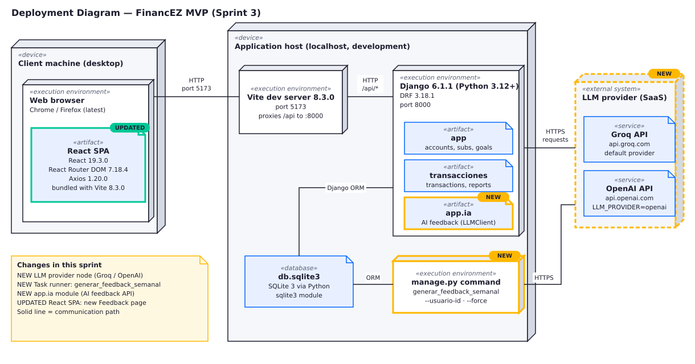
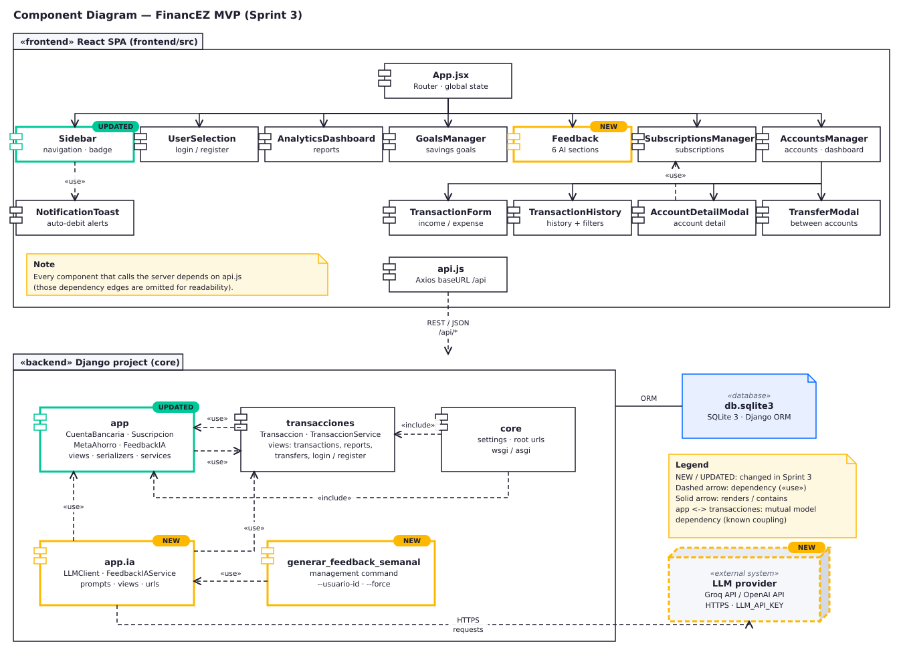
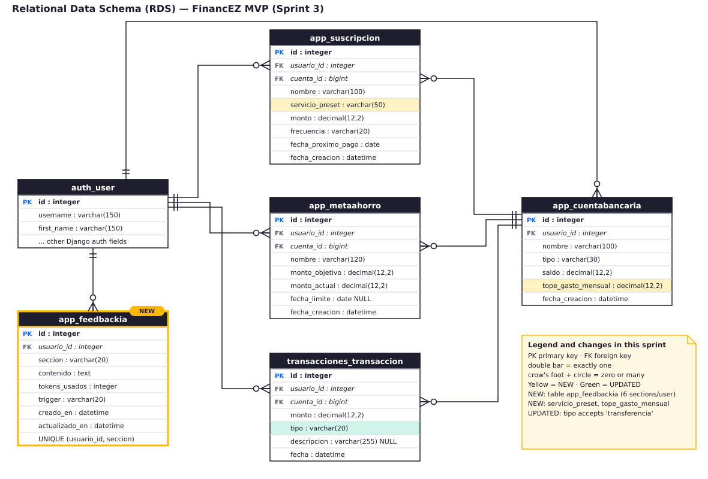

# Wiki_03 — MVP Deliverable 3

---

## 1. Architecture & Data

### 1.1 Deployment Diagram



Editable source (draw.io): [`docs/diagrams/deployment.drawio`](docs/diagrams/deployment.drawio) · image: [`docs/diagrams/deployment.svg`](docs/diagrams/deployment.svg)

**Description:**  
The system follows a **client-server architecture**. A React single-page application (SPA) runs in the user's browser and talks to a Django REST backend. During development the browser loads the SPA from the Vite dev server (port 5173), which proxies every `/api/*` request to Django (port 8000). Django persists the data in an SQLite file and, for the AI feedback feature, calls an external LLM provider (Groq by default, or OpenAI) over HTTPS.

**Nodes & Technologies:**

| Node | Technology | Version | Purpose |
|------|------------|---------|---------|
| **Client machine / Web browser** | Chrome / Firefox running the React SPA | React 19.3.0, React Router DOM 7.18.4, Axios 1.20.0 | SPA rendering, routing, state management |
| **Frontend dev server** | Vite | 8.3.0 | Serves and bundles the SPA, hot-module replacement, proxies `/api/*` to the backend |
| **Backend (application server)** | Django + Django REST Framework | 6.1.1 / 3.18.1 (Python 3.12+) | REST endpoints, business logic, ORM, name-only login |
| **Database** | SQLite file `db.sqlite3` | SQLite 3, accessed through Python's `sqlite3` module and the Django ORM | Persistent storage (development) |
| **Task runner** | Django management command `generar_feedback_semanal` | — | Batch generation of the weekly AI feedback (run manually or from cron / Task Scheduler) |
| **External AI service** | Groq API (default) / OpenAI API | Groq default model `llama-3.1-70b-versatile`; for OpenAI set `LLM_MODEL` (e.g. `gpt-4o`) | LLM inference for financial feedback |

**Network Connections:**
- Browser → Vite dev server: HTTP, port 5173.
- Vite dev server → Django backend: HTTP, port 8000 (proxy of every `/api/*` request; the browser never calls port 8000 directly).
- Django backend → SQLite: Django ORM, local file.
- Django backend → Groq / OpenAI: HTTPS (`api.groq.com` / `api.openai.com`) using the `requests` library and the `LLM_API_KEY` environment variable.
- Task runner (`manage.py generar_feedback_semanal`) → SQLite through the Django ORM, and → LLM provider over HTTPS. It runs as its own process and does not go through the HTTP API.

**Changes from Previous Sprint:**
- Added the **External AI service** node (Groq / OpenAI) for LLM integration.
- Added the **Task runner** node for the `generar_feedback_semanal` management command.
- Added the **`app.ia`** module to the backend.
- Updated the React SPA: new **Feedback** page (`/feedback`) consuming the `/api/ia/feedback/` endpoints.

---

### 1.2 Component Diagram



Editable source (draw.io): [`docs/diagrams/components.drawio`](docs/diagrams/components.drawio) · image: [`docs/diagrams/components.svg`](docs/diagrams/components.svg)

**Architectural Overview:**  
The backend is a Django project (`core`) made of three Django apps: `app` (accounts, subscriptions, savings goals, `FeedbackIA` model), `transacciones` (transactions, reports, transfers, login/registration) and `app.ia` (AI feedback). Business rules live in service modules (`TransaccionService`, auto-debit processing, `FeedbackIAService`) and are exposed through DRF views. The `domain/` and `infra/` folders under `transacciones` are reserved for a future DDD layering (entities/repositories) and are intentionally empty in this sprint. The frontend is a React SPA organised by feature components; every component that talks to the server uses the shared Axios instance in `api.js`.

#### Backend Components (Django Apps)

```
┌─────────────────────────────────────────────────────────────────┐
│                        DJANGO PROJECT (core)                     │
├──────────────────┬────────────────────┬────────────────────────┤
│     app/         │   transacciones/   │      app/ia/           │
│  (Accounts,      │  (Transactions,    │   (AI Feedback)        │
│   Goals, Subs)   │   Transfers)       │                        │
└────────┬─────────┴────────┬───────────┴──────────┬─────────────┘
         │                 │                      │
         ▼                 ▼                      ▼
   models (Django ORM)   services   →   views (DRF API layer)
```

| Module | Main elements |
|--------|---------------|
| `app/` | Models `CuentaBancaria`, `Suscripcion`, `MetaAhorro`, `FeedbackIA`; `services.py` → `procesar_autodebitos_suscripciones()`; views for accounts, subscriptions and goals CRUD and auto-debit processing; `signals.py` (triggers AI feedback on new goal / subscription / large expense) |
| `transacciones/` | Model `Transaccion`; `services.py` → `TransaccionService` (`registrar_gasto_con_proteccion_meta()`, `obtener_reporte_financiero()`); views `ListaTransaccionesView`, `DetalleTransaccionView`, `ReporteFinancieroView`, `TransferenciaEntreCuentasView`, `RegistrarUsuarioView`, `LoginUsuarioView`; empty `domain/` and `infra/` |
| `app/ia/` | `LLMClient`, `FeedbackIAService`, prompts; views `ContextoFinancieroView`, `FeedbackIAView`, `FeedbackStatsView` |
| `app/management/commands/` | `generar_feedback_semanal` (`--usuario-id`, `--force`) |
| `core/` | Settings, root URLs, WSGI/ASGI |

#### Frontend Components (React)

```
App.jsx (Router + Global State: usuario, cuentas, suscripciones)
│
├── UserSelection (Login/Register)
├── Sidebar (Navigation + subscription alerts badge)
├── NotificationToast (Auto-debit alerts)
│
├── Pages:
│   ├── Dashboard (/dashboard) → AccountsManager
│   │    ├── TransactionForm
│   │    ├── TransactionHistory
│   │    ├── AccountDetailModal
│   │    └── TransferModal
│   ├── Suscripciones (/suscripciones) → SubscriptionsManager
│   ├── Analytics (/analytics) → AnalyticsDashboard
│   ├── Metas (/metas) → GoalsManager
│   └── Feedback (/feedback) → Feedback (6 tabs: General, Cuentas, Gastos, Metas, Suscripciones, Reportes)
│
└── api.js (Axios instance with baseURL '/api')
```

**Component Descriptions (per module)**  

| Module | Responsibility |
|--------|----------------|
| **app** | Accounts, subscriptions, savings goals, `FeedbackIA` model, auto-debit processing. |
| **transacciones** | Business logic for transactions, reports, transfers and name-only login/registration. |
| **app.ia** | LLM client, feedback generation, prompt handling, token statistics. |
| **generar_feedback_semanal** | Management command that generates the six AI sections for users. |
| **App.jsx** | Routing, global state, composition root. |
| **UserSelection** | Name-only login/registration flow. |
| **Sidebar** | Navigation, shows the subscription-due badge. |
| **AccountsManager** | List/create/edit/delete accounts, show balances (page `/dashboard`). |
| **TransactionForm / TransactionHistory** | Register income and expenses; transaction history with filters. |
| **AccountDetailModal** | Account detail. |
| **TransferModal** | Transfer money between accounts. |
| **SubscriptionsManager** | CRUD subscriptions, upcoming payments, auto-debit processing. |
| **AnalyticsDashboard** | Financial aggregates, recent transactions. |
| **GoalsManager** | CRUD savings goals, allocate/release funds. |
| **Feedback** | Tabbed view of 6 AI-generated sections, per-section regeneration. |
| **NotificationToast** | Transient alerts for auto-debits. |
| **api.js** | Axios instance pointing to `/api`. |

**Component Dependencies:**

*Frontend (taken from the `import` statements of the code):*
- `App.jsx` → `UserSelection`, `Sidebar`, `AccountsManager`, `SubscriptionsManager`, `AnalyticsDashboard`, `GoalsManager`, `Feedback`, `NotificationToast`, `api.js`.
- `AccountsManager` → `TransactionForm`, `TransactionHistory`, `AccountDetailModal`, `TransferModal`, `api.js`.
- `AccountDetailModal` → `SubscriptionsManager` (imports `SERVICES_CATALOG`) and `api.js`.
- `Sidebar` → `NotificationToast` (imports `calcularDiasRestantes`).
- `UserSelection`, `AnalyticsDashboard`, `GoalsManager`, `Feedback`, `SubscriptionsManager`, `TransactionForm`, `TransactionHistory`, `TransferModal` → `api.js`.
- `api.js` → backend REST API (`/api/*`), through the Vite proxy in development.

*Backend (taken from the `import` statements of the code):*
- `app` (views, services) → `transacciones.models.Transaccion`; `transacciones` (models, services) → `app.models` (`CuentaBancaria`, `MetaAhorro`). The two apps therefore depend on each other at model level, a known coupling of the MVP.
- `app.ia` → `app.models`, `transacciones.models` and `TransaccionService` (to build the financial context sent to the LLM) and → the external LLM provider over HTTPS.
- `app.signals` → `app.ia.services.FeedbackIAService` (automatic feedback on new goal / subscription / large expense).
- `generar_feedback_semanal` → `app.ia.services.FeedbackIAService`.
- `core` → root URL configuration that includes `app.urls` (which in turn includes `app.ia.urls`) and `transacciones.urls`.
- `app` and `transacciones` models → `db.sqlite3` through the Django ORM.

**Changes from Previous Sprint:**
- Added the **`app.ia`** module (LLMClient, FeedbackIAService, prompts).
- Added the **Feedback** page with a 6-section tabbed interface.
- Added the **`FeedbackIA`** model for persisted AI responses.
- Added the **management command** for weekly batch generation.
- Frontend: new `Feedback.jsx`; `Sidebar.jsx` updated with Brain icon + badge.

---

### 1.3 Data Model (Relational Database Schema)



Editable source (draw.io): [`docs/diagrams/data-model.drawio`](docs/diagrams/data-model.drawio) · image: [`docs/diagrams/data-model.svg`](docs/diagrams/data-model.svg)

**Current Tables (SQLite):**

| Table | Columns |
|-------|---------|
| `auth_user` (Django auth) | `id` PK, `username`, `first_name`, … |
| `app_cuentabancaria` | `id` PK, `usuario_id` FK→auth_user, `nombre` varchar(100), `tipo` varchar(30), `saldo` decimal(12,2), `tope_gasto_mensual` decimal(12,2), `fecha_creacion` datetime |
| `app_suscripcion` | `id` PK, `usuario_id` FK→auth_user, `cuenta_id` FK→app_cuentabancaria, `nombre` varchar(100), `servicio_preset` varchar(50), `monto` decimal(12,2), `frecuencia` varchar(20), `fecha_proximo_pago` date, `fecha_creacion` datetime |
| `app_metaahorro` | `id` PK, `usuario_id` FK→auth_user, `cuenta_id` FK→app_cuentabancaria, `nombre` varchar(120), `monto_objetivo` decimal(12,2), `monto_actual` decimal(12,2), `fecha_limite` date NULL, `fecha_creacion` datetime |
| `app_feedbackia` | `id` PK, `usuario_id` FK→auth_user, `seccion` varchar(20), `contenido` text, `tokens_usados` integer, `trigger` varchar(20), `creado_en` datetime, `actualizado_en` datetime — `UNIQUE(usuario_id, seccion)` |
| `transacciones_transaccion` | `id` PK, `usuario_id` FK→auth_user, `cuenta_id` FK→app_cuentabancaria, `monto` decimal(12,2), `tipo` varchar(20) (ingreso / gasto / transferencia), `descripcion` varchar(255) NULL, `fecha` datetime |

Allowed values: `tipo` of an account = Ahorros, Corriente, Billetera Digital, Tarjeta de Crédito; `frecuencia` = Mensual, Anual; `seccion` = general, cuentas, gastos, metas, suscripciones, reportes; `trigger` = weekly, new_meta, new_suscripcion, large_gasto, meta_cumplida, manual.

**Key Relationships:**
- `User 1:N CuentaBancaria` (related_name=`cuentas`)
- `User 1:N Suscripcion`, `User 1:N MetaAhorro`
- `CuentaBancaria 1:N Suscripcion` (related_name=`suscripciones`)
- `CuentaBancaria 1:N MetaAhorro` (related_name=`metas_ahorro`)
- `User 1:N Transaccion` (related_name=`transacciones`)
- `CuentaBancaria 1:N Transaccion` (related_name=`transacciones`)
- `User 1:N FeedbackIA` (related_name=`feedbacks_ia`)

**Changes from Previous Sprint:**
- Added the **app_feedbackia** table (6 sections per user, upsert on regeneration).
- Added the **servicio_preset** field to Suscripcion.
- Added **tope_gasto_mensual** to CuentaBancaria.
- Transaccion `tipo` now includes `'transferencia'` (was only ingreso/gasto).

---

---

## 2. Corporate Image

### Logo


### Slogan
**Organiza hoy, respira mañana**

### Colour Palette
| Role | Hex | Swatch |
|------|-----|--------|
| Primary | `#0066FF` |  |
| Secondary | `#00C896` |  |
| Accent | `#FFB800` |  |
| Dark Neutral | `#1E1E2F` |  |
| Light Background | `#F5F7FA` |  |

### Screenshots


---

---

## 4. Usability & User Experience Acceptance Test

### 4.1 System Information
- **System Name:** FinancEZ — Personal Finance Manager
- **Version:** MVP v1.0

### 4.2 General Objective of the Test
Evaluate how effectively, efficiently, and satisfactorily end users can interact with the system to accomplish core financial management tasks: account management, transaction recording, subscription tracking, savings goals, and AI-powered feedback consumption.

### 4.3 Scope of Evaluation

**Functionalities / Modules to Evaluate:**
1. **User Onboarding** — Login/Register via name-only flow
2. **Dashboard / Accounts** — View, create, edit, delete bank accounts; see balances
3. **Transactions** — Record income/expense; transfer between accounts; view history with filters
4. **Subscriptions** — Create recurring subscriptions; auto-debit processing; upcoming payment alerts
5. **Savings Goals** — Create goals; allocate/release funds; progress tracking
6. **Analytics** — Financial report (income/expense/balance/transfers); recent transactions
7. **AI Feedback** — View 6-section feedback; regenerate per-section or all; token stats

**Out of Scope:**
- Admin panel (Django admin)
- Scheduled execution of the weekly feedback command (`generar_feedback_semanal` is not evaluated by end users; the AI feedback itself is in scope through the Feedback page)
- LLM prompt engineering / model selection
- Production deployment / HTTPS / PostgreSQL migration
- Multi-currency support
- Bank API integration (open banking)

### 4.4 Input and Output Criteria

**Input Criteria (Prerequisites):**
- Test accounts: 2+ pre-created users with varied data (accounts, transactions, subscriptions, goals)
- Devices: Desktop browser (Chrome/Firefox latest)
- Network: Local development (http://localhost:5173 → http://localhost:8000)
- Backend running with `LLM_API_KEY` configured for AI feedback
- Pre-seeded data script (or manual setup) for consistent starting state

**Output Criteria (Success Thresholds):**
| Metric | Target |
|--------|--------|
| Task completion rate | ≥ 90% per task |
| Time on task (core flows) | ≤ 2 min for simple, ≤ 5 min for complex |
| Error rate (user-induced) | ≤ 1 per task |
| SUS score | ≥ 68 (acceptable) |
| Likert satisfaction (1–5) | ≥ 4.0 average |

### 4.5 User Profile Definition
- **Type:** End-user (personal finance manager)
- **Age range:** 22–45
- **Technical skills:** Basic to intermediate (comfortable with web apps, mobile banking)
- **Experience with similar systems:** Used at least one finance app (YNAB, Mint, Fintonic, bank app)
- **Context of use:** Desktop, home/office environment, single session ~20–30 min

### 4.6 Success Metrics
| Metric | Measurement |
|--------|-------------|
| Task completion rate | % of users finishing each task without help |
| Time on task | Seconds from task start to success/error |
| Error rate | Count of user errors (wrong input, navigation mistakes) |
| SUS score | 10-item questionnaire, 1–5 scale → normalized 0–100 |
| Likert satisfaction | 5-point scale per module + overall |

### 4.7 Usability Indicators
| Indicator | Evaluation Method |
|-----------|-------------------|
| Learnability | First-time task completion without instructions |
| Efficiency | Time on task for repeat vs. first attempt |
| Error prevention & recovery | Inline validation, confirm modals, undo via delete |
| Memorability | Task completion after 10-min break / second session |
| User satisfaction | SUS + Likert + qualitative observations |

### 4.8 Scales and Instruments
- **System Usability Scale (SUS)** — 10 items, 5-point Likert
- **Custom post-task questionnaire** — 5-point Likert per module (ease, clarity, usefulness)
- **Observation checklist** — Evaluator marks: hesitation, backtracking, errors, verbal comments
- **Think-aloud protocol** — User verbalizes thoughts during tasks

### 4.9 Test Procedure Description
1. **Introduction (3 min)** — Explain purpose, assure no "wrong answers," start recording
2. **Briefing & Consent (2 min)** — Sign consent, explain think-aloud
3. **Task Execution (15–20 min)** — User performs 7 core tasks (one per module) in order:
   - T1: Register/Login with name
   - T2: Create a bank account with initial balance
   - T3: Record an expense and an income
   - T4: Create a subscription with next payment date
   - T5: Create a savings goal and allocate funds
   - T6: View analytics report
   - T7: Open Feedback page, read General section, regenerate "Gastos" section
4. **Observation & Data Collection** — Evaluator times each task, counts errors, notes behavior
5. **Post-test Questionnaire (5 min)** — SUS + per-module Likert + open feedback
6. **Debrief (2 min)** — Clarify observations, thank participant

### 4.10 Evaluator Role
- Guide session per script
- Provide task instructions one at a time
- Observe silently; only intervene if user is completely stuck (>2 min)
- Record: task start/end time, errors, clicks, verbalizations
- Do **not** hint, correct, or explain UI during tasks

### 4.11 Instructions for the User
> "Perform each task as you would in real life. Think aloud — say what you're looking for, what you expect, any confusion. There are no right or wrong answers; we're testing the system, not you."

### 4.12 Test Execution Results (Minimum Two Users)

#### User 1 – Nicolás Ortiz
- **Profile:** 28 years, software engineer, daily user of banking apps, high tech comfort.  
- **Tasks performed:** T1‑T7 all completed.  
- **Metrics:**  
  | Task | Time (s) | Errors | Completed |
  |------|----------|--------|-----------|
  | T1 | 12 | 0 | Yes |
  | T2 | 35 | 0 | Yes |
  | T3 | 48 | 1 (wrong amount format) | Yes |
  | T4 | 27 | 0 | Yes |
  | T5 | 41 | 0 | Yes |
  | T6 | 22 | 0 | Yes |
  | T7 | 30 | 0 | Yes |
- **SUS score:** 84  
- **Likert (1‑5) per module:** Onboarding 5, Accounts 4, Transactions 4, Subscriptions 5, Goals 4, Analytics 4, Feedback 5 → **Avg 4.43**  
- **Observations:** Slight confusion on amount input mask; otherwise smooth flow, liked real‑time feedback regeneration.

#### User 2 – Thomas Bedoya
- **Profile:** 31 years, product manager, moderate tech comfort, uses Mint weekly.  
- **Tasks performed:** T1‑T7 all completed.  
- **Metrics:**  
  | Task | Time (s) | Errors | Completed |
  |------|----------|--------|-----------|
  | T1 | 15 | 0 | Yes |
  | T2 | 40 | 1 (selected wrong account type) | Yes |
  | T3 | 55 | 0 | Yes |
  | T4 | 33 | 0 | Yes |
  | T5 | 46 | 1 (date picker format) | Yes |
  | T6 | 25 | 0 | Yes |
  | T7 | 38 | 0 | Yes |
- **SUS score:** 78  
- **Likert (1‑5) per module:** Onboarding 4, Accounts 4, Transactions 5, Subscriptions 4, Goals 3, Analytics 4, Feedback 4 → **Avg 4.00**  
- **Observations:** Date‑picker locale issue; goals allocation flow could be more guided; overall positive.

### 4.13 Results Analysis
- **Usability issues observed (from the tables above):**  
  1. Amount input format: Nicolás made one error on T3 (wrong amount format) and noted the amount input mask was confusing; Thomas had no error on this task.  
  2. Date picker: Thomas made one error on T5 (date format) and reported a locale issue (the picker shows MM/DD/YYYY while he expected DD/MM/YYYY); Nicolás had no date errors.  
  3. Goals allocation flow: Thomas rated Goals 3/5 and commented that the flow could be more guided.  
  4. Account type selection: Thomas selected the wrong account type once on T2.
- **Performance differences:** Total task time was 215 s for Nicolás and 252 s for Thomas (Nicolás ~15 % faster). Thomas's slowest tasks were T3 (55 s), T5 (46 s) and T2 (40 s).
- **System strengths:** Both users completed all seven tasks; clean navigation, instant AI feedback regeneration (Feedback rated 5 and 4), clear subscription badge (Subscriptions rated 5 and 4).
- **Critical pain points:** Input format of amounts, date locale, and missing inline guidance on goals.
- **Limitation:** The test was run with only two participants, so these results are indicative and not statistically representative.

### 4.14 Conclusions and Improvement Opportunities
- Against the thresholds defined in 4.4, the system **meets** them for the two participants tested: completion 100 % (≥ 90 %), SUS 84 and 78 (≥ 68), Likert averages 4.43 and 4.00 (≥ 4.0), at most 1 error per task and every task within the 2-min / 5-min limits.  
- **Key improvements for next sprint:**  
  1. Redesign the amount input with a clear placeholder and auto-formatting.  
  2. Localise the date picker to the user locale (DD/MM/YYYY).  
  3. Add a contextual tooltip on the goals allocation screen.  
  4. Make the account type selector clearer (labels / default).  
  5. Conduct a follow-up test with more participants after the fixes to verify the SUS result.

---

## 5. Project Management

### 5.1 Backlog (Current Sprint Features)

| ID | User Story | Acceptance Criteria | Status | Responsible |
|----|------------|---------------------|--------|-------------|
| US-01 | Register/Login by name | User enters name → creates/gets user → redirected to dashboard | Done | **Nicolás Ortiz** |
| US-02 | CRUD Bank Accounts | Create/edit/delete accounts with type, balance, monthly cap | Done | **Thomas Bedoya** |
| US-03 | Record Transactions | Income/Expense/Transfer with account, amount, description | Done | **Nicolás Ortiz** |
| US-04 | Goal Protection on Expense | Expense > free balance → auto-deduct from goals + alert | Done | **Thomas Bedoya** |
| US-05 | Subscriptions Auto-Debit | Due subscriptions are processed by the auto-debit endpoint (`/api/suscripciones/procesar-autodebitos/`) → creates expense tx | Done | **Nicolás Ortiz** |
| US-06 | Savings Goals CRUD | Create goals linked to account; allocate/release funds | Done | **Thomas Bedoya** |
| US-07 | Financial Reports | Aggregate income/expense/transfer; recent transactions list | Done | **Nicolás Ortiz** |
| US-08 | AI Feedback (6 sections) | Generate/read per-section feedback via LLM; token tracking | Done | **Thomas Bedoya** |
| US-09 | Weekly Feedback Command | `generar_feedback_semanal` processes all active users | Done | **Nicolás Ortiz** |
| US-10 | Subscription Alerts | Sidebar badge + toast for payments due in ≤7 days | Done | **Thomas Bedoya** |

### 5.2 Weekly Meetings  

**Meeting 1 – 2026‑09‑02**  

- **Nicolás Ortiz:** Worked on basic login session for functionality.  
- **Thomas Bedoya:** Will fix bugs appearing on login page.  
- **Blockers:** New bugs on login page; DB inconsistencies.

**Meeting 2 – 2026‑09‑09**  

- **Nicolás Ortiz:** Login page completed.  
- **Thomas Bedoya:** Deciding AI implementation approach (chatbot vs feedback).  
- **Blockers:** Understanding DB inconsistencies.

**Meeting 3 – 2026‑09‑16**  

- **Nicolás Ortiz:** Agreed with teacher on AI feedback approach.  
- **Thomas Bedoya:** Starting AI structure development.  
- **Blockers:** None.

**Meeting 4 – 2026‑09‑23**  

- **Nicolás Ortiz:** Completed AI feedback implementation.  
- **Thomas Bedoya:** Refining AI frontend UI.  
- **Blockers:** Making LLM consume user data for personalised feedback.

**Product Owner Sync (2026‑09‑30)** – Discussed MVP scope, approved AI feedback direction, set demo date.

**Project Manager Follow‑up (2026‑10‑07)** – Reviewed sprint velocity, confirmed backlog priorities for next sprint.

### 5.3 Retrospective  

- **Continue:**  
  - Daily stand‑ups kept short and focused.  
  - Pair programming on critical backend services.  
  - Automated CI pipeline catching regressions early.  

- **Start:**  
  - Write unit tests for each new service before merging.  
  - Adopt a shared component library (Storybook) for UI consistency.  
  - Schedule a dedicated “bug‑bash” day each sprint.  

- **Stop:**  
  - Direct commits to `main` without PR review.  
  - Manual DB migrations on production‑like environments.  
  - Leaving TODO comments in shipped code.

---

## 6. Sprint Review  

**Pitch (delivered by Nicolás Ortiz):**  
> “FinancEZ now offers a complete personal‑finance workspace: instant onboarding, multi‑account dashboard, transaction & subscription tracking, savings‑goal protection, analytical reports, and AI‑driven feedback—all behind a clean, brand‑consistent UI.”

**Demo (by team members):**  
1. **Login & onboarding** (Nicolás) – name‑only flow, instant dashboard.  
2. **Account & transaction management** (Thomas) – create account, record income/expense, transfer.  
3. **Subscription auto‑debit & alerts** (Nicolás) – add subscription, show badge & toast.  
4. **Savings goals with protection** (Thomas) – create goal, allocate funds, expense triggers protection.  
5. **Analytics report** (Nicolás) – aggregated view, recent transactions.  
6. **AI Feedback page** (Thomas) – six tabs, per‑section regeneration, token usage display.  

**High‑value requirements delivered this sprint:** US‑01 through US‑10 (core MVP).  

**Feedback from Product Owner:** Positive on AI feedback usefulness; requested bulk‑action toolbar for transactions and keyboard shortcuts for board navigation – added to next sprint backlog.

---

*End of Wiki_03 — MVP Deliverable 3 (updated as wiki_030.md)*